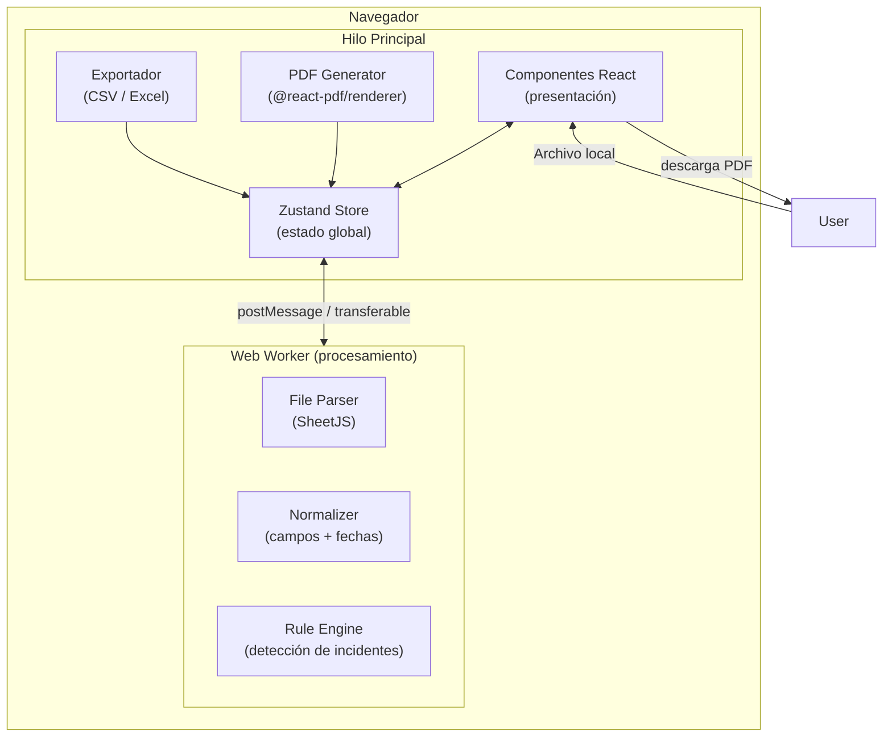
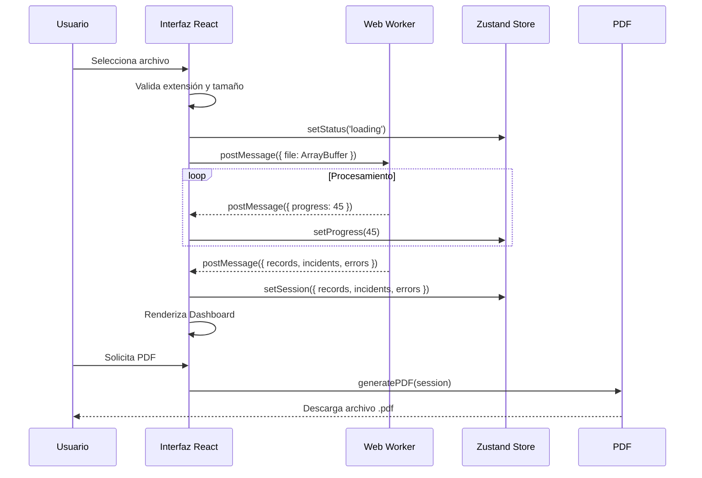
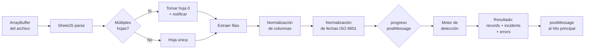

# Documento de Diseño Técnico — SOC Incident Analyzer

## Resumen de investigación

Antes de redactar el diseño se investigaron las siguientes áreas:

- **SheetJS (xlsx)**: Librería pura JS para lectura de `.xlsx`/`.xls`/`.csv` en el navegador. Soporta lectura por ArrayBuffer, lo que la hace compatible con Web Workers. Parsear 50.000 filas puede tardar entre 2–8 s dependiendo del número de columnas; operar en un Worker evita bloquear el hilo principal.
- **@react-pdf/renderer**: Librería de generación de PDF basada en componentes React (JSX) que corre en el navegador. Produce PDF ≥ 1.4, soporta tablas, texto, imágenes y estilos propios. Es la opción más natural para un stack React/TypeScript puro-cliente. Alternativa a pdfmake (orientada a definición JSON) o jsPDF (orientada a dibujo imperativo); `@react-pdf/renderer` fue seleccionada por su coherencia con el modelo de componentes.
- **Zustand**: Librería de estado global para React (≈2 KB). Ofrece stores reactivos sin Provider envolvente, selectores finos que evitan re-renders innecesarios y soporte TypeScript de primera clase. Es la opción más pragmática para una SPA con estado de sesión complejo.
- **Recharts**: La librería de gráficos React más popular (≈49 M descargas/semana). Basada en SVG, declarativa, con soporte nativo TypeScript. Adecuada para los volúmenes de datos esperados en este dominio (máx. miles de puntos por gráfico).
- **Web Workers**: Los requisitos de procesamiento (50.000 filas en < 30 s sin bloquear la UI) exigen mover el trabajo pesado fuera del hilo principal. La API de Web Workers nativa del navegador, integrada mediante `vite-plugin-worker` en el build, es la solución estándar.

---

## Overview

SOC Incident Analyzer es una **Single Page Application (SPA)** React + TypeScript que corre íntegramente en el navegador del usuario. Permite a analistas de SOC Nivel 2:

1. Cargar un archivo de logs (`.xlsx`, `.xls`, `.csv`) sin ninguna transmisión a servicios externos.
2. Normalizar y procesar los registros en un Web Worker para mantener la UI responsiva.
3. Detectar y clasificar incidentes de seguridad mediante un motor de reglas configurable.
4. Visualizar resultados en un dashboard interactivo con filtros en tiempo real.
5. Exportar datos y generar un informe PDF profesional de 10 secciones.

**Principios clave de diseño:**
- *Local-first*: ningún dato abandona el navegador.
- *Separación de capas*: parsing → normalización → detección → presentación son capas independientes.
- *Rendimiento sin fricciones*: el hilo principal nunca procesa filas de datos; solo gestiona estado y UI.
- *Accesibilidad por diseño*: WCAG 2.1 AA es un requisito, no un añadido posterior.

---

## Architecture

### Diagrama de capas



### Diagrama de flujo de datos



### Estructura de carpetas del proyecto

```
src/
├── assets/                 # Iconos SVG, fuentes
├── components/
│   ├── ui/                 # Primitivos (Button, Badge, Card, Modal…)
│   ├── FileUploader/
│   ├── Dashboard/
│   │   ├── SummaryCards/
│   │   ├── RiskDistributionChart/
│   │   ├── TimelineChart/
│   │   ├── TopIPsTable/
│   │   └── TopEventTypesTable/
│   ├── IncidentList/
│   │   ├── IncidentCard/
│   │   └── FilterBar/
│   └── PDFReport/          # Componentes @react-pdf/renderer
├── workers/
│   └── processor.worker.ts # Web Worker
├── lib/
│   ├── parser/             # SheetJS wrapper
│   ├── normalizer/         # Normalización de campos y fechas
│   ├── ruleEngine/         # Motor de detección de incidentes
│   ├── pdfGenerator/       # Lógica de construcción del documento PDF
│   └── exporter/           # CSV / Excel export
├── store/
│   └── sessionStore.ts     # Zustand store
├── types/
│   └── index.ts            # Tipos compartidos
├── constants/
│   └── rules.ts            # Definición de reglas de detección
└── App.tsx
```

---

## Components and Interfaces

### Componentes principales

#### `<FileUploader />`
- Área de arrastrar y soltar + botón de selección de archivo.
- Valida extensión y tamaño antes de enviar al Worker.
- Muestra nombre, tamaño formateado (KB/MB con 2 decimales) y barra de progreso.
- Emite eventos: `onFileAccepted`, `onFileRejected`, `onProgress`.

#### `<Dashboard />`
- Contenedor del panel principal; se compone de sub-componentes.
- Lee del store: `session.records`, `session.incidents`, `session.filters`.
- Muestra estado vacío cuando no hay sesión activa.

#### `<SummaryCards />`
- Indicadores: total registros, total incidentes, conteo por nivel de riesgo (5 tarjetas).
- Cada tarjeta lleva un icono de seguridad distinto y el color de acento del nivel.

#### `<RiskDistributionChart />`
- Gráfico de barras (Recharts `BarChart`) o pastel (Recharts `PieChart`) que muestra la distribución por nivel de riesgo.
- Cada segmento muestra conteo absoluto y porcentaje.

#### `<TimelineChart />`
- Gráfico de líneas/área (Recharts `AreaChart`) con agrupación dinámica: por hora si rango ≤ 48 h, por día si rango > 48 h.
- Solo se muestra cuando el campo de fecha/hora está disponible.

#### `<TopIPsTable />` / `<TopEventTypesTable />`
- Tablas con las 10 IPs de origen / tipos de evento más frecuentes, ordenadas descendentemente.
- Solo se muestran cuando los campos correspondientes están disponibles.

#### `<FilterBar />`
- Controles de filtro: selector de Nivel_de_riesgo (multi-select), rango de fecha/hora (date-range picker), campo de texto para IP de origen.
- Aplica cambios en < 2 s al store; el dashboard se actualiza reactivamente.

#### `<IncidentList />`
- Lista virtual (usando `@tanstack/react-virtual`) de tarjetas de incidentes.
- Cada tarjeta muestra: identificador, nivel de riesgo con badge de color, motivo, fecha y conteo de registros de respaldo.
- Desplegable para ver los registros de respaldo completos.

#### `<PDFGenerator />`
- Botón de generación habilitado solo cuando existe sesión activa con análisis completado.
- Llama a `generatePDF(session)` de `lib/pdfGenerator/`.
- Muestra spinner durante la generación y botón de descarga al finalizar.

### Interfaces de librería (contratos de módulo)

```typescript
// lib/parser/index.ts
interface ParseResult {
  headers: string[];
  rows: RawRow[];
  sheetName: string;
  multipleSheets: boolean;
}
function parseFile(buffer: ArrayBuffer, fileExtension: string): Promise<ParseResult>;

// lib/normalizer/index.ts
function normalizeRecords(headers: string[], rows: RawRow[]): NormalizedRecord[];

// lib/ruleEngine/index.ts
interface DetectionResult {
  incidents: Incident[];
  skippedRules: SkippedRule[];
}
function detectIncidents(records: NormalizedRecord[], config: RuleConfig): DetectionResult;

// lib/pdfGenerator/index.ts
function generatePDF(session: ActiveSession): Promise<Blob>;

// lib/exporter/index.ts
function exportToCSV(incidents: Incident[]): string;
function exportToExcel(incidents: Incident[]): ArrayBuffer;
```

---

## Data Models

### Tipos base

```typescript
/** Fila cruda leída por SheetJS antes de cualquier procesamiento */
type RawRow = Record<string, unknown>;

/** Campos reconocidos en el esquema estándar */
type RecognizedField =
  | 'timestamp'
  | 'sourceIP'
  | 'destinationIP'
  | 'user'
  | 'eventType'
  | 'sourceSystem'
  | 'description'
  | 'status'
  | 'severity';

/** Registro normalizado — resultado de la capa de normalización */
interface NormalizedRecord {
  _rowIndex: number;                          // Índice de fila original
  fields: Partial<Record<RecognizedField, NormalizedFieldValue>>;
  extra: Record<string, unknown>;            // Columnas no reconocidas, sin modificar
  parseWarnings: ParseWarning[];             // Advertencias de normalización (ej. fecha no parseable)
}

interface NormalizedFieldValue {
  raw: unknown;           // Valor original tal como viene del archivo
  normalized: unknown;    // Valor normalizado (fecha ISO 8601, string, etc.)
  status: 'ok' | 'absent' | 'unparseable';
}

interface ParseWarning {
  field: RecognizedField;
  message: string;        // ej. "Fecha no normalizable: valor conservado como texto"
}
```

### Incidente

```typescript
type RiskLevel = 'CRÍTICO' | 'ALTO' | 'MEDIO' | 'BAJO' | 'INFORMATIVO';

interface TriggeredRule {
  ruleId: string;
  ruleName: string;
  severity: RiskLevel;
  details?: string;       // Información adicional (ej. IP que disparó fuerza bruta)
}

interface Incident {
  id: string;             // UUID generado en detección
  riskLevel: RiskLevel;   // Nivel de la regla de mayor severidad
  reason: string;         // Texto legible: nombre(s) de regla(s) + nivel
  triggeredRules: TriggeredRule[];
  evidenceRecords: NormalizedRecord[]; // Registros de respaldo (campos originales preservados)
  firstTimestamp: string | null;       // ISO 8601 o null si no disponible
  lastTimestamp: string | null;
}
```

### Sesión activa

```typescript
type SessionStatus =
  | 'idle'          // Sin sesión activa
  | 'validating'    // Validando archivo (extensión, tamaño)
  | 'parsing'       // Web Worker parseando
  | 'normalizing'   // Normalizando registros
  | 'detecting'     // Detectando incidentes
  | 'ready'         // Análisis completado
  | 'error';        // Error irrecuperable

interface FileMetadata {
  name: string;
  sizeBytes: number;
  formattedSize: string;  // "1.23 MB" o "456.78 KB"
  extension: '.xlsx' | '.xls' | '.csv';
  sheetName?: string;
  multipleSheets: boolean;
}

interface ProcessingError {
  rowIndex?: number;
  message: string;
  cause?: string;
}

interface ActiveFilters {
  riskLevels: RiskLevel[];           // Vacío = sin filtro
  dateRange: { from: string | null; to: string | null };
  sourceIP: string;                  // Vacío = sin filtro
}

interface ActiveSession {
  status: SessionStatus;
  progress: number;                  // 0–100
  file: FileMetadata | null;
  totalRecords: number;
  records: NormalizedRecord[];
  incidents: Incident[];
  processingErrors: ProcessingError[];
  filters: ActiveFilters;
  analysisTimestamp: string | null;  // ISO 8601
}
```

### Store Zustand

```typescript
interface SessionStore extends ActiveSession {
  // Acciones
  loadFile: (file: File) => Promise<void>;
  clearSession: () => void;
  setFilters: (filters: Partial<ActiveFilters>) => void;
  resetFilters: () => void;
  // Selectores derivados
  filteredIncidents: () => Incident[];
  incidentsByRiskLevel: () => Record<RiskLevel, number>;
}
```

### Configuración del motor de reglas

```typescript
interface RuleConfig {
  workingHours: {
    start: number;  // Hora local (0-23), por defecto 8
    end: number;    // Hora local (0-23), por defecto 18
    daysOfWeek: number[];  // 1=Lunes … 7=Domingo, por defecto [1,2,3,4,5]
  };
  bruteForce: {
    threshold: number;     // Por defecto 5
    windowMinutes: number; // Por defecto 10
  };
}

interface DetectionRule {
  id: string;
  name: string;
  severity: RiskLevel;
  requiredFields: RecognizedField[];
  evaluate: (record: NormalizedRecord, context: DetectionContext) => boolean;
}
```

---

## Motor de detección de incidentes

### Reglas implementadas

| ID | Nombre | Severidad | Campos requeridos |
|----|--------|-----------|-------------------|
| `AUTH_FAILURE` | Intento fallido de autenticación | MEDIO | `status` |
| `UNAUTHORIZED_ACCESS` | Acceso no autorizado | ALTO | `status`, `description` |
| `AFTER_HOURS` | Actividad fuera de horario laboral | BAJO | `timestamp` |
| `BRUTE_FORCE` | Ataque de fuerza bruta | CRÍTICO | `sourceIP`, `status`, `timestamp` |
| `CRITICAL_SEVERITY` | Evento de severidad crítica | CRÍTICO | `severity` |

### Algoritmo de detección por fuerza bruta (ventana deslizante)

```
Para cada IP con registros de autenticación fallida:
  1. Ordenar eventos por timestamp ascendente
  2. Usar puntero izquierdo (i) y derecho (j)
  3. Mientras j < len(eventos):
     a. Si eventos[j].timestamp - eventos[i].timestamp > 10min: avanzar i
     b. Si j - i + 1 >= threshold: marcar IP como brute force; avanzar i
     c. Avanzar j
  Complejidad: O(n) por IP
```

### Selección de Nivel_de_riesgo

```
severityOrder = { CRÍTICO: 5, ALTO: 4, MEDIO: 3, BAJO: 2, INFORMATIVO: 1 }
assignedLevel = max(triggeredRules.map(r => severityOrder[r.severity]))
```

La regla `CRITICAL_SEVERITY` solo se dispara si `record.fields.severity.normalized` contiene explícitamente uno de los valores: `"critical"`, `"crítico"`, `"crit"` (comparación case-insensitive). Si el campo está ausente o contiene otro valor, no se dispara.

---

## Pipeline de procesamiento en el Web Worker



El Worker emite mensajes de progreso cada vez que procesa un lote de 1.000 filas, garantizando actualizaciones al menos cada 2 s para archivos de hasta 50.000 filas.

---

## Estructura del informe PDF

El `@react-pdf/renderer` construye el documento a partir de componentes JSX. El PDF generado contiene exactamente estas secciones en el orden especificado:

| # | Sección | Contenido |
|---|---------|-----------|
| 1 | Portada | Logo/título, nombre del informe, fecha de generación (ISO 8601) |
| 2 | Resumen ejecutivo | Totales por nivel de riesgo, hallazgos destacados |
| 3 | Descripción del archivo analizado | Nombre, tamaño, hojas, total de registros procesados |
| 4 | Metodología de análisis | Descripción del motor de reglas y criterios de detección |
| 5 | Estadísticas generales | Tabla de conteos, gráfico de distribución como imagen SVG |
| 6 | Listado de incidentes | Tabla: ID, Nivel_de_riesgo, motivo, fecha primer registro, conteo |
| 7 | Evidencias y registros de respaldo | Por incidente: tabla con todos los campos del registro original |
| 8 | IPs y usuarios involucrados | Tabla de IPs más activas y usuarios identificados |
| 9 | Recomendaciones de mitigación | Texto derivado de los niveles de riesgo detectados |
| 10 | Conclusiones | Texto basado en estadísticas generales de la sesión |

Las secciones 9 y 10 son generadas dinámicamente a partir de plantillas parametrizadas con los datos de la sesión — nunca contienen texto de marcador de posición.

---

## Paleta de colores y tema

```typescript
const RISK_COLORS = {
  CRÍTICO:     { bg: '#B91C1C', text: '#FFFFFF' }, // Rojo
  ALTO:        { bg: '#C2410C', text: '#FFFFFF' }, // Naranja
  MEDIO:       { bg: '#B45309', text: '#FFFFFF' }, // Amarillo oscuro
  BAJO:        { bg: '#15803D', text: '#FFFFFF' }, // Verde
  INFORMATIVO: { bg: '#1D4ED8', text: '#FFFFFF' }, // Azul
} as const;

const THEME = {
  background: '#0F172A',    // Azul muy oscuro (slate-900)
  surface:    '#1E293B',    // Azul oscuro (slate-800)
  border:     '#334155',    // Slate-700
  textPrimary:'#F1F5F9',    // Slate-100
  textMuted:  '#94A3B8',    // Slate-400
  accent:     '#3B82F6',    // Azul (blue-500)
} as const;
```

Todos los pares de color fondo/texto cumplen una relación de contraste ≥ 4.5:1 según WCAG 2.1 AA (verificado contra la fórmula de luminancia relativa).

---

## Correctness Properties

*Una propiedad es una característica o comportamiento que debe mantenerse verdadero a través de todas las ejecuciones válidas del sistema — esencialmente, un enunciado formal sobre lo que el sistema debe hacer. Las propiedades sirven de puente entre especificaciones legibles por humanos y garantías de corrección verificables por máquina.*

---

### Property 1: Formato de tamaño de archivo

*Para cualquier* tamaño de archivo expresado en bytes, la función de formateo debe producir una cadena con exactamente dos decimales de precisión, usando la unidad KB si el tamaño es menor a 1 MB y la unidad MB si el tamaño es mayor o igual a 1 MB.

**Validates: Requirements 1.2**

---

### Property 2: Rechazo de extensiones no permitidas

*Para cualquier* nombre de archivo cuya extensión no sea `.xlsx`, `.xls` ni `.csv`, la función de validación debe devolver un resultado de error.

**Validates: Requirements 1.3**

---

### Property 3: Rechazo de archivos que superan 50 MB

*Para cualquier* tamaño de archivo mayor a 52.428.800 bytes (50 MB), la validación de tamaño debe devolver un error; para cualquier tamaño menor o igual a ese límite con extensión válida, la validación de tamaño no debe devolver error.

**Validates: Requirements 1.4**

---

### Property 4: Vista previa acotada a 20 filas

*Para cualquier* array de filas de datos, la función de vista previa debe devolver exactamente `min(filas.length, 20)` filas.

**Validates: Requirements 1.5**

---

### Property 5: Limpieza completa de sesión al cargar nuevo archivo

*Para cualquier* estado de sesión activa existente, tras cargar un nuevo archivo todos los campos derivados de la sesión anterior (registros, incidentes, errores, filtros, indicadores) deben ser reemplazados por los datos del nuevo archivo, sin residuos de la sesión previa.

**Validates: Requirements 1.7, 6.5**

---

### Property 6: Mapeo de columnas reconocidas y preservación de columnas extra

*Para cualquier* conjunto de encabezados de columna, la función de mapeo debe asignar los campos reconocidos a sus claves estándar correspondientes, conservar las columnas no reconocidas sin modificarlas y marcar como `'absent'` los campos reconocidos que no estén presentes.

**Validates: Requirements 2.1, 2.2, 2.3**

---

### Property 7: Normalización de fechas a ISO 8601

*Para cualquier* cadena de fecha/hora parseable como fecha válida, la función de normalización debe producir una cadena en formato ISO 8601 (`YYYY-MM-DDTHH:MM:SS±HH:MM`). Para cualquier cadena no parseable, debe preservar el valor original y marcar el campo como `'unparseable'`.

**Validates: Requirements 2.4, 2.5**

---

### Property 8: Tolerancia a filas ilegibles

*Para cualquier* lote de filas que contenga tanto filas válidas como filas ilegibles, el resultado del procesamiento debe contener únicamente las filas válidas y el registro de errores debe contener exactamente una entrada por cada fila ilegible con su número de fila.

**Validates: Requirements 2.9**

---

### Property 9: Asignación del nivel de riesgo máximo

*Para cualquier* conjunto no vacío de reglas disparadas sobre un registro, el nivel de riesgo asignado al incidente resultante debe ser igual al nivel de mayor severidad entre todas las reglas del conjunto, según el orden `CRÍTICO > ALTO > MEDIO > BAJO > INFORMATIVO`.

**Validates: Requirements 3.2**

---

### Property 10: Motivo de clasificación no vacío

*Para cualquier* incidente generado por el motor de detección, el campo `reason` debe ser una cadena no vacía que referencie el nombre de al menos una de las reglas disparadas.

**Validates: Requirements 3.3**

---

### Property 11: Preservación de campos originales en evidencias

*Para cualquier* registro que genere un incidente, todos los campos originales del registro (incluyendo columnas extra no reconocidas) deben estar presentes e inalterados en los registros de respaldo (`evidenceRecords`) del incidente.

**Validates: Requirements 3.4**

---

### Property 12: No generación de falsos positivos por campos ausentes

*Para cualquier* registro en el que los campos requeridos por una regla de detección estén marcados como `'absent'`, esa regla no debe generar ningún incidente.

**Validates: Requirements 3.5**

---

### Property 13: Detección de fuerza bruta por ventana deslizante

*Para cualquier* secuencia de eventos de autenticación fallida asociados a una misma IP de origen, la detección de fuerza bruta debe ocurrir si y solo si existe alguna ventana temporal de 10 minutos que contenga 5 o más eventos de esa IP.

**Validates: Requirements 3.6**

---

### Property 14: Asignación de CRÍTICO solo por campo de severidad explícito

*Para cualquier* registro, el nivel CRÍTICO debe asignarse mediante la regla `CRITICAL_SEVERITY` únicamente si el campo `severity` del registro contiene explícitamente un valor que indique nivel crítico (comparación case-insensitive: `"critical"`, `"crítico"`, `"crit"`). Si el campo está ausente o contiene otro valor, esa regla específica no debe dispararse.

**Validates: Requirements 3.7**

---

### Property 15: Corrección estadística del dashboard

*Para cualquier* lista de incidentes, las estadísticas calculadas (total de incidentes, conteo por nivel de riesgo) deben ser exactamente iguales al recuento directo de los incidentes de la lista; y los porcentajes por nivel de riesgo deben sumar 100 % (tolerancia de ±0.01 % por redondeo de punto flotante).

**Validates: Requirements 4.1, 4.2**

---

### Property 16: Agrupación temporal dinámica

*Para cualquier* conjunto de registros con campo `timestamp` disponible, la función de agrupación temporal debe producir cubetas por hora si el rango total (`max_timestamp − min_timestamp`) es ≤ 172.800 segundos (48 h), y cubetas por día si el rango es mayor.

**Validates: Requirements 4.3**

---

### Property 17: Top-10 IPs y tipos de evento correctamente ordenados

*Para cualquier* lista de registros con campo de IP de origen o tipo de evento disponible, la función de ranking debe devolver los elementos con mayor conteo primero, el resultado debe tener longitud `min(elementosDistintos, 10)`, y los conteos deben ser exactos.

**Validates: Requirements 4.4, 4.5**

---

### Property 18: Estructura completa del documento PDF

*Para cualquier* sesión activa con análisis completado, el árbol de componentes del documento PDF generado debe contener exactamente las 10 secciones requeridas en el orden especificado, y ningún campo de contenido textual debe contener cadenas de marcador de posición.

**Validates: Requirements 5.2, 5.3**

---

### Property 19: Vista de detalle de incidentes completa

*Para cualquier* lista de incidentes en la sesión activa, la vista de lista de incidentes debe renderizar un elemento por cada incidente, y cada elemento debe mostrar el nivel de riesgo, el motivo de clasificación y el conteo de registros de respaldo.

**Validates: Requirements 6.1**

---

### Property 20: Filtrado por nivel de riesgo

*Para cualquier* lista de incidentes y cualquier valor de filtro por nivel de riesgo, el resultado filtrado debe contener únicamente los incidentes cuyo `riskLevel` coincida con el valor del filtro.

**Validates: Requirements 6.2, 6.4**

---

### Property 21: Campos obligatorios en exportación

*Para cualquier* lista de incidentes, cada fila del archivo exportado (CSV o Excel) debe contener los campos: `id`, `riskLevel`, `reason`, `firstTimestamp` en formato ISO 8601 y `evidenceCount`.

**Validates: Requirements 6.3**

---

### Property 22: Relaciones de contraste WCAG

*Para cada* combinación definida de color de fondo y texto en la paleta de niveles de riesgo y el tema de la aplicación, la relación de contraste calculada según la fórmula de luminancia relativa WCAG 2.1 debe ser ≥ 4.5:1.

**Validates: Requirements 7.2**

---

### Property 23: Modelo de error estructurado

*Para cualquier* error producido por los módulos de la aplicación (carga, procesamiento, generación de PDF), el objeto de error expuesto a la UI debe tener un campo `message` no vacío, un campo `cause` no vacío y un campo `suggestedAction` no vacío.

**Validates: Requirements 7.4**

---

## Error Handling

### Estrategia por capa

| Capa | Tipo de error | Estrategia |
|------|--------------|-----------|
| FileUploader | Extensión inválida | Validación síncrona antes de enviar al Worker; mensaje descriptivo en pantalla |
| FileUploader | Tamaño > 50 MB | Validación síncrona; mensaje con límite y tamaño actual |
| FileUploader | Archivo corrupto | Error del Worker propagado al store; mensaje con causa y sugerencia de verificar el archivo |
| Normalizer | Fecha no parseable | Valor original conservado + `ParseWarning` en el registro; sin interrupción del flujo |
| Normalizer | Fila ilegible | Fila omitida + entrada en `processingErrors`; procesamiento continúa |
| RuleEngine | Campo ausente | Regla omitida silenciosamente; sin error al usuario |
| PDFGenerator | Fallo en generación | Error capturado, Blob parcial descartado, botón restablecido, mensaje con acción sugerida |
| Exporter | Lista vacía | Mensaje informativo indicando que no hay datos para exportar |

### Interfaz de error para la UI

```typescript
interface AppError {
  code: string;           // Ej. "FILE_TOO_LARGE", "UNSUPPORTED_FORMAT"
  message: string;        // Descripción del problema en español
  cause: string;          // Causa técnica (ej. "El archivo supera 50 MB")
  suggestedAction: string;// Acción correctiva (ej. "Seleccione un archivo de menor tamaño")
}
```

---

## Testing Strategy

### Pruebas unitarias con ejemplos

Se usará **Vitest** + **@testing-library/react** como framework principal.

Escenarios concretos a cubrir:
- Validación de extensión con extensiones permitidas y no permitidas
- Validación de tamaño con valores en el límite (exactamente 50 MB, 50 MB + 1 byte)
- Vista previa con array de 5, 20 y 100 filas
- Normalización de fechas con formatos comunes (DD/MM/YYYY, MM-DD-YYYY, timestamps Unix)
- Detección de fuerza bruta con exactamente 4, 5 y 6 intentos en ventana
- Estado vacío del dashboard sin sesión
- Error en generación de PDF con restablecimiento de botón

### Pruebas de propiedades (Property-Based Testing)

Se usará **fast-check** como librería de PBT.

Cada prueba de propiedad se configura con mínimo **100 iteraciones** y se etiqueta con el formato:

```
// Feature: soc-incident-analyzer, Property N: <texto de la propiedad>
```

Propiedades a implementar como tests de propiedad (mapeadas a las propiedades de corrección del diseño):

| Test | Propiedad | Library |
|------|-----------|---------|
| Formato de tamaño (bytes → KB/MB) | Propiedad 1 | fast-check `fc.nat()` |
| Rechazo de extensiones arbitrarias | Propiedad 2 | fast-check `fc.string()` |
| Rechazo de tamaños > 50 MB | Propiedad 3 | fast-check `fc.nat()` |
| Vista previa acotada | Propiedad 4 | fast-check `fc.array()` |
| Limpieza de sesión | Propiedad 5 | fast-check `fc.record()` |
| Mapeo de columnas | Propiedad 6 | fast-check `fc.array(fc.string())` |
| Normalización de fechas | Propiedad 7 | fast-check `fc.date()` |
| Tolerancia a filas ilegibles | Propiedad 8 | fast-check `fc.array()` |
| Nivel de riesgo máximo | Propiedad 9 | fast-check `fc.subarray()` |
| Motivo no vacío | Propiedad 10 | fast-check `fc.record()` |
| Preservación de campos | Propiedad 11 | fast-check `fc.record()` |
| No falsos positivos | Propiedad 12 | fast-check `fc.record()` |
| Ventana deslizante brute force | Propiedad 13 | fast-check `fc.array(fc.date())` |
| Asignación CRÍTICO explícito | Propiedad 14 | fast-check `fc.string()` |
| Estadísticas del dashboard | Propiedad 15 | fast-check `fc.array()` |
| Agrupación temporal | Propiedad 16 | fast-check `fc.array(fc.date())` |
| Top-10 ordenado | Propiedad 17 | fast-check `fc.array()` |
| Estructura PDF | Propiedad 18 | fast-check `fc.record()` |
| Vista de incidentes completa | Propiedad 19 | fast-check `fc.array()` |
| Filtrado por nivel | Propiedad 20 | fast-check `fc.array()` + `fc.constantFrom()` |
| Campos obligatorios exportación | Propiedad 21 | fast-check `fc.array()` |
| Contraste WCAG | Propiedad 22 | fast-check `fc.constantFrom()` sobre paleta definida |
| Modelo de error estructurado | Propiedad 23 | fast-check `fc.constantFrom()` sobre códigos de error |

### Pruebas de integración y rendimiento

- **Procesamiento de 50.000 filas**: benchmark con dataset sintético, verificar completado < 30 s.
- **Generación de PDF con 500 incidentes**: verificar completado < 60 s.
- **Filtros con dataset grande**: verificar tiempo de respuesta < 2 s en dashboard y < 300 ms en lista de incidentes.

### Pruebas de accesibilidad

- Integración de **axe-core** en el test runner para verificación automática de roles ARIA, etiquetas y contraste.
- Tests de navegación por teclado para los flujos principales (carga de archivo, aplicación de filtros, generación de PDF).

### Pruebas de compatibilidad de navegadores

- **Playwright** para tests end-to-end en Chrome, Firefox, Edge y Safari (versiones estables).

---

## Consideraciones de rendimiento

- **Web Worker obligatorio** para todo el pipeline de parsing, normalización y detección. El hilo principal nunca bloquea.
- **Procesamiento por lotes**: el Worker procesa filas en lotes de 1.000 emitiendo mensajes de progreso, lo que permite a la UI mostrar actualizaciones frecuentes sin saturar el canal de mensajes.
- **Virtualización de listas**: `@tanstack/react-virtual` para la lista de incidentes, evitando el renderizado de miles de nodos DOM.
- **Selectores Zustand granulares**: cada componente suscribe solo las partes del store que necesita, minimizando re-renders.
- **Transferable objects**: el `ArrayBuffer` del archivo se transfiere (no copia) al Worker mediante `transfer`, eliminando la penalización de serialización para archivos grandes.
- **Memoización**: cálculos derivados costosos (top-10 IPs, agrupación temporal, estadísticas) se calculan una vez al completar el análisis y se almacenan en el store; los filtros aplican sobre los datos ya calculados sin recalcular desde cero.
